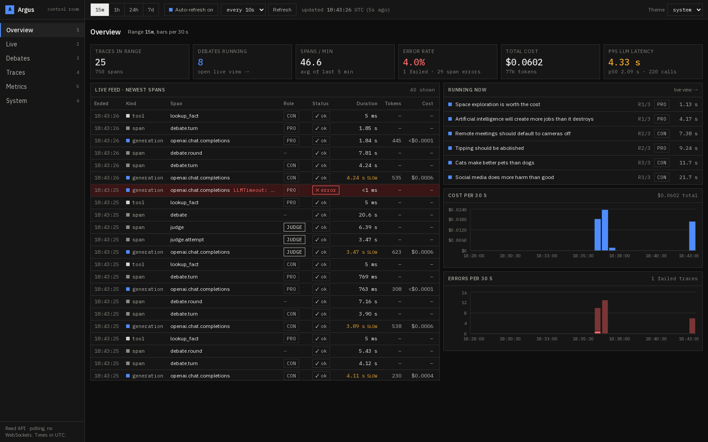
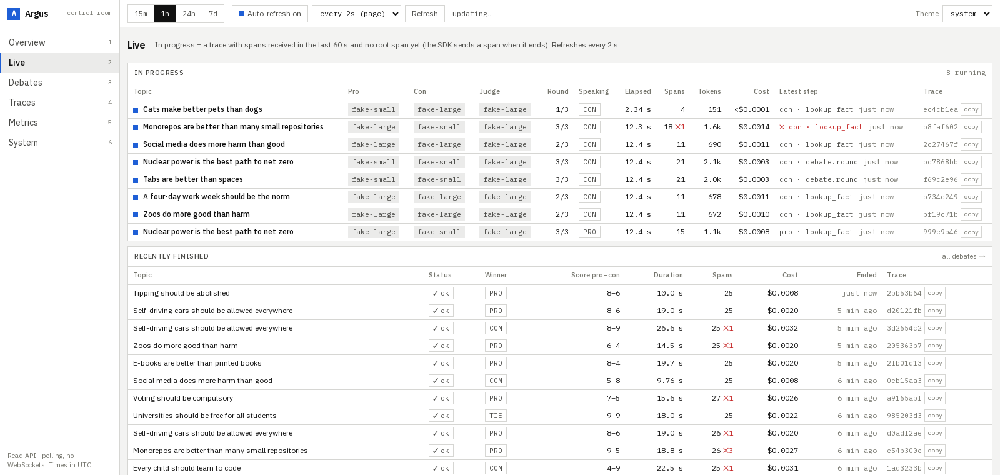
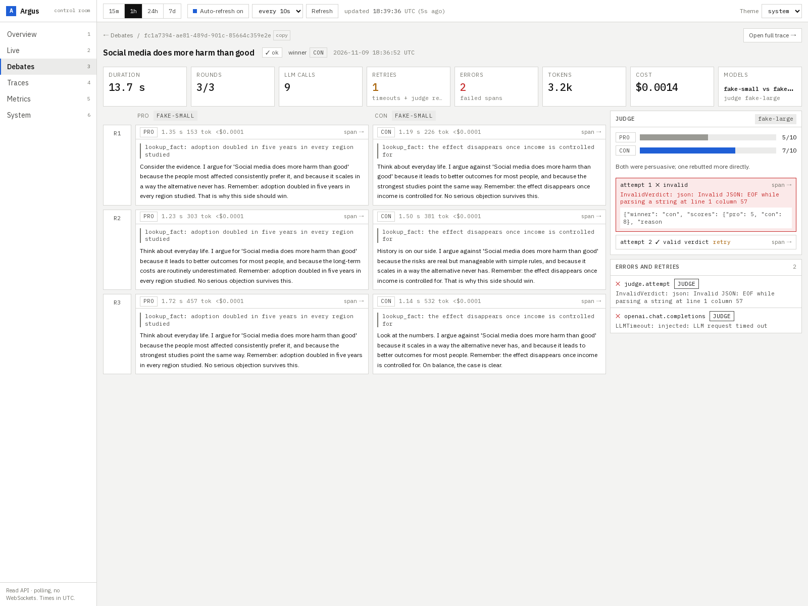
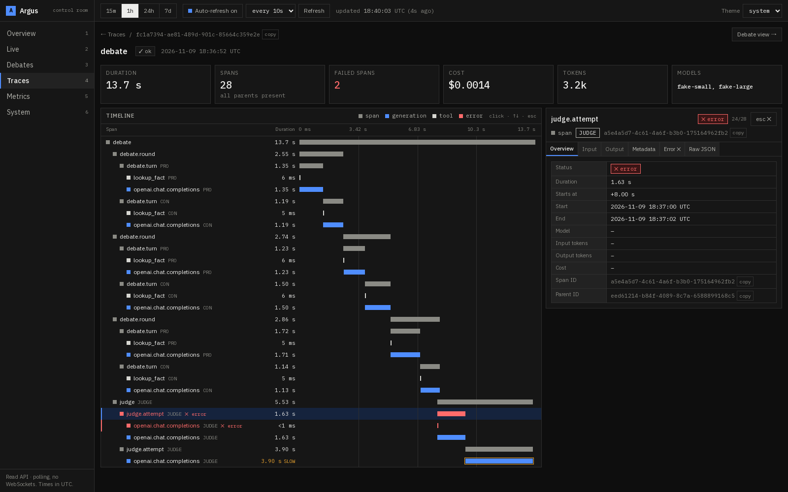
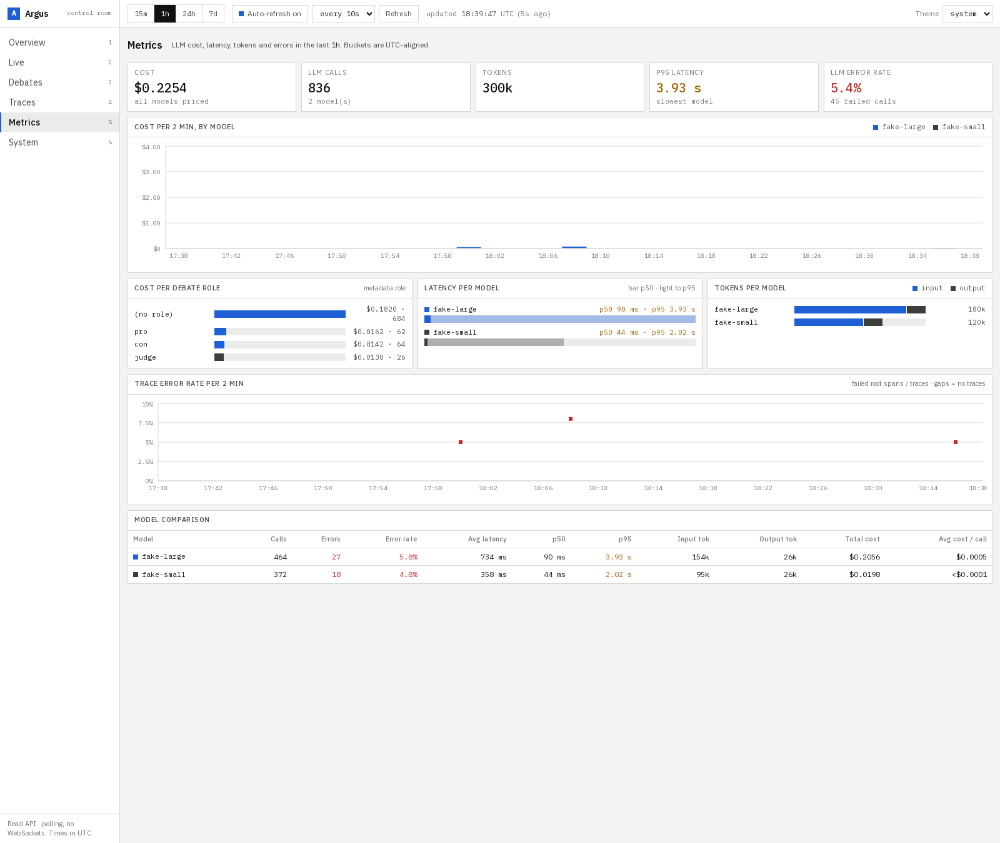
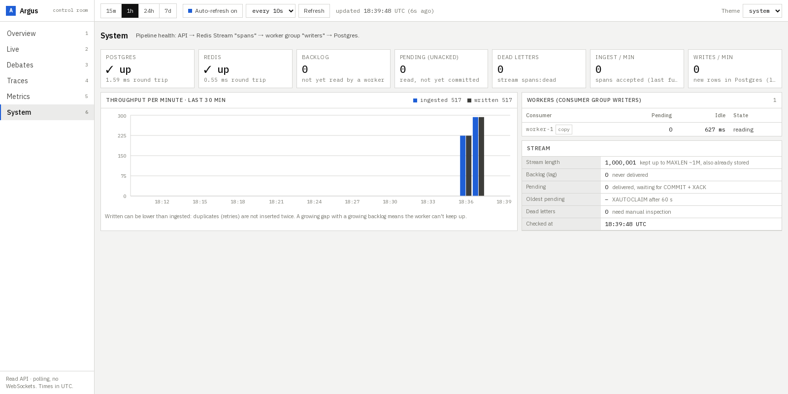
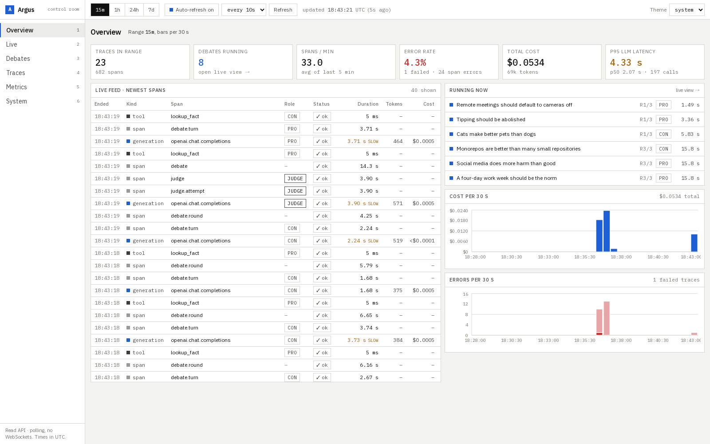

# Argus

**Self-hosted tracing for LLM applications.** A small Python SDK records every model call,
tool call and step of your app as nested spans. A FastAPI + Redis Streams + Postgres pipeline
ingests them, and a Next.js dashboard shows each trace as a timeline, plus cost, latency and
error rates. Think of it as a small, focused [Langfuse](https://langfuse.com).

The repo also contains the **AI Debate Arena**: two LLMs debate a topic and a third judges.
It runs on **real models only**: both debaters are `llama3.2:3b` on a local Ollama, the judge is
`openai/gpt-oss-120b` on Groq's free tier. It exists to produce realistic traces, including
real rate limits (429), slow CPU inference, plus injected timeouts and invalid judge JSON, so
every failure path of the tracer is exercised.

A one-person portfolio project, built in about a week.



## Dashboard

A dense "control room": a fixed sidebar (keys 1-6) and a top bar with the time range
(15m / 1h / 24h / 7d), auto-refresh with an interval, "last updated" and the theme (light / dark /
system). Square corners, 1px borders, greys plus one accent; red only for errors, amber only for
slow (≥ 2 s) calls and warnings; monospace for IDs, numbers and JSON. Pages poll the read API
(`router.refresh()`, paused while the tab is hidden); every panel has loading, empty and error
states, and every ID can be copied.

| Page | What it shows |
|---|---|
| **Overview** `/` | Traces in range, debates running, spans/min, error rate, cost, p95; live feed of the newest spans; running debates; cost and error bars |
| **Live** `/live` | Debates in progress (topic, models per role, round x/y, current speaker, elapsed, spans, tokens, cost, latest step), refreshed every 2 s; recently finished with winner |
| **Debates** `/debates/[id]` | Pro and Con side by side per round, fact lookups, LLM retries, judge attempts with the invalid JSON, verdict and scores, every error linked to its span |
| **Traces** `/traces/[id]` | Filters and cursor paging; waterfall + inspector (Overview / Input / Output / Metadata / Error / Raw JSON), ↑/↓ between spans, Esc closes, `?span=` deep links |
| **Metrics** `/metrics` | Cost per bucket and model, cost per debate role, p50/p95 per model, tokens per model, error-rate step line, model comparison table |
| **System** `/system` | Postgres/Redis status, stream backlog, pending (unacked) messages, dead letters, workers, ingested vs written per minute |

"In progress" means a trace with no root span yet and a span received in the last 60 s: the SDK
sends spans when they end, so the root arrives last. The arena tags every span with
`argus.attributes(topic=..., round=..., role=...)`, so a running debate's topic and speaker are
known before it finishes.

| Live (light) | Debate |
|---|---|
|  |  |
| **Trace + inspector (dark)** | **Metrics** |
|  |  |
| **System** | **Overview (light)** |
|  |  |

---

## Architecture

```mermaid
flowchart LR
    subgraph app["Your LLM app (e.g. Debate Arena)"]
        code["@observe · span() · wrap_openai"] --> queue["bounded queue<br/>10k, drop oldest"]
        queue --> exporter["exporter thread<br/>batches ≤ 100 · retry + jitter"]
    end

    exporter -- "POST /v1/ingest<br/>X-API-Key" --> api["FastAPI ingest<br/>413 → 401 → 422 → 202"]
    api -- "XADD in MULTI<br/>MAXLEN ~ 1M" --> stream[("Redis Stream<br/>spans")]
    stream -- "XREADGROUP 'writers'<br/>≤ 500 msgs" --> worker["worker<br/>INSERT … ON CONFLICT DO NOTHING<br/>XACK after COMMIT"]
    stream -. "XAUTOCLAIM<br/>idle > 60 s" .-> worker
    worker -. "poison message" .-> dead[("spans:dead")]
    worker --> pg[("PostgreSQL<br/>spans · model_prices")]
    pg --> read["read API<br/>/v1/traces · /v1/metrics"]
    read -- "server-side only,<br/>key from env" --> dash["Next.js dashboard"]
```



**One span's journey:** the SDK records a span when it ends and puts it in an in-memory queue
(instant, never blocks your code). A background thread sends batches to `POST /v1/ingest`. The
API checks size, API key and schema, appends one message per span to a Redis Stream and answers
`202` right away. A worker reads the stream in a consumer group, computes cost from the price
table valid at the span's start time, inserts idempotently and acknowledges only after the
commit. The dashboard reads traces through the same API and builds the span tree itself.

Every piece is explained for beginners in [`docs/LEARNING.md`](docs/LEARNING.md).

---

## Quick start

Needs Docker (and `make`; on Windows without `make`, run the command behind each target
from the [`Makefile`](Makefile)). For the Debate Arena you also need
[Ollama](https://ollama.com) on the host (`ollama pull llama3.2:3b`) and a free
[Groq API key](https://console.groq.com/keys).

```bash
cp .env.example .env             # set POSTGRES_PASSWORD and GROQ_API_KEY
docker compose up -d --build     # postgres, redis, server :8000, worker, dashboard :3000
make migrate                     # apply SQL migrations (incl. model prices)
make seed                        # prints an API key → put it in ARGUS_API_KEY in .env
docker compose up -d             # recreate the dashboard with the key
make demo TOPIC="Tabs are better than spaces"   # one real debate = one trace (~2 min on CPU)
make traffic N=4                 # 4 debates, 2 at a time (CONCURRENCY=2 by default)
```

> Variables set in your shell override `.env` for `docker compose`. If spans are rejected
> with `401 invalid API key`, check for a stale `ARGUS_API_KEY` in your terminal
> (PowerShell: `Remove-Item Env:ARGUS_API_KEY`).

Open <http://localhost:3000>.

Instrumenting your own code:

```python
import argus
from openai import OpenAI

argus.init(api_key="argus_...", host="http://localhost:8000")
client = argus.wrap_openai(OpenAI())  # every call becomes a "generation" span


@argus.observe()  # works on sync and async functions
def answer(question: str) -> str:
    with argus.span("retrieve", kind="tool"):
        context = search(question)
    messages = [{"role": "user", "content": f"{context}

{question}"}]
    reply = client.chat.completions.create(model="gpt-4o-mini", messages=messages)
    return reply.choices[0].message.content
```

| Command | What it does |
|---|---|
| `make test` | pytest for server, SDK and demo, plus the dashboard unit tests (all in Docker) |
| `make lint` | ruff check + format check |
| `make load` | k6 load test of `POST /v1/ingest` with synthetic spans (see below) |
| `make chaos` | synthetic traffic while killing the worker and API; verifies exactly-once storage |

---

## Measured numbers

All on one laptop: Windows 11, Docker Desktop (16 vCPUs, 7.6 GB), with k6, the API, Redis,
Postgres and the worker competing for the same CPUs. Batches of 100 spans (the SDK's batch
size), a third of them LLM generations with ~500 bytes of prompt and output. Raw results are in
[`loadtest/results/`](loadtest/results).

The load and chaos tests send **synthetic spans** straight to the API and never call an LLM, so
they run without Ollama or Groq. A real debate, for comparison: ~25 spans in 1.5–2 minutes
(each `llama3.2:3b` turn takes 13–30 s on CPU; the Groq judge ~1–2 s).

### Ingest (`make load`, k6, 30 s per run)

| API processes | Concurrency | Spans / s | Requests / s | p50 | **p95** | p99 | Failed |
|---|---|---:|---:|---:|---:|---:|---:|
| 1 | 1 VU (sequential) | 2,769 | 28 | 11 ms | **17 ms** | 27 ms | 0 |
| 1 | 20 VUs (saturated) | 9,121 | 91 | 201 ms | **267 ms** | 292 ms | 0 |
| 4 (`WEB_CONCURRENCY=4`) | 40 VUs (saturated) | **21,898** | 219 | 92 ms | **385 ms** | 426 ms | 0 |

- **Unloaded, a batch of 100 spans is accepted in 11 ms (p95 17 ms).** With one VU the
  throughput is limited by k6 building the batches, not by the API.
- **One API process saturates at ~9,100 spans/s.** It is CPU-bound on parsing and validating
  JSON with Pydantic. Past that point extra clients only queue: 20 in flight ÷ 91 req/s ≈ 220 ms,
  which is exactly the measured latency (Little's law).
- **The API scales with processes:** 4 processes take ~2.4× as much (21,900 spans/s). It is less
  than 4× because k6 and the other services share the same machine.

### Worker (Redis → Postgres)

| | Spans / s |
|---|---:|
| One worker, 500 messages per batch, `executemany` INSERT with the cost subquery | **~3,400** |

The worker is the bottleneck. That's by design: the Redis Stream absorbs the difference. In
the 4-process run the API accepted 660k spans in 30 s; the worker had stored 85k by then and
finished the rest 164 s later without losing anything. The flip side: with `MAXLEN ~ 1,000,000`,
sustained overload at ~18,500 spans/s above the drain rate would start trimming unstored spans
after about 54 s. Scaling workers (and `COPY`) is the first item under "What I'd do next".

### Chaos test (`make chaos`)

6 senders posted 20-span batches for 75 s while the worker and the API were killed or
restarted 8 times: worker `SIGKILL` → start, API graceful restart, API `SIGKILL` → start, both
`SIGKILL` at once → start, worker graceful restart. Like the SDK, senders retry the **same**
batch (same span IDs) until they get `202`. On top of that, 10% of accepted batches were sent a
second time on purpose.

| Metric | Result |
|---|---:|
| Requests sent | 4,497 |
| Requests that failed while a container was down (retried) | 96 |
| Batches deliberately sent twice | 424 (8,480 duplicate spans) |
| Unique spans accepted (`202`) | 88,020 |
| Rows stored in Postgres | **88,020** |
| Missing / duplicate / unexpected rows | **0 / 0 / 0** |
| Pending messages left in Redis | 0 |
| Fully stored after the last send | 2.4 s |

Every accepted span was stored exactly once. That is **at-least-once delivery** (client retries,
`XACK` only after commit, a restarted worker re-reads its own pending messages) combined with
**idempotent inserts** (SDK-generated span IDs, `ON CONFLICT (project_id, id) DO NOTHING`).

---

## Design decisions

The full table, about 50 rows with trade-offs, lives in [`CLAUDE.md`](CLAUDE.md#design-decisions-keep-updated).
These are the important ones:

| Decision | Why | Trade-off |
|---|---|---|
| **SDK-generated UUIDv4 span IDs + `INSERT … ON CONFLICT DO NOTHING`**, PK `(project_id, id)` | Retries and redeliveries can resend a span; storing it twice must be impossible | Relies on IDs being unique; random UUIDs scatter B-tree inserts (UUIDv7 would fix that) |
| **`202` after `XADD`; a worker writes to Postgres** | Ingest stays fast and absorbs bursts; a slow or restarting database doesn't reach clients | Data sits briefly in Redis, so Redis needs AOF persistence; the stream length is capped |
| **`XACK` only after `COMMIT`; `XAUTOCLAIM` stale messages; stable worker names** | A crash anywhere means "deliver again", never "lost" | A dead worker's messages wait 60 s for another worker (its own restart resumes at once) |
| **The SDK never blocks or crashes the host app**: bounded queue (drop oldest), daemon thread, short timeouts, retries only on network errors / 5xx with full jitter | Observability must not become an outage | Under extreme load or a long outage spans are dropped (counted in `get_stats()`) |
| **The current span lives in a `ContextVar`** | Correct parents for nested sync code, `async` code and concurrent `asyncio` tasks | Threads start with an empty context: work in a thread starts a new trace unless you copy the context |
| **Send spans when they end** (no start/end events) | One event, one row, a simple protocol | Long-running spans are invisible until they finish |
| **No FK on `parent_span_id`; the dashboard builds the tree** | Children can arrive before parents; orphans are shown as "parent missing", never hidden | The tree must be checked at read time |
| **Cost computed on the server, in the `INSERT`** from a versioned `model_prices` table | One source of truth; history keeps the price that applied at the time; NULL ("unknown") ≠ 0 ("free") | Price changes don't re-price old spans |
| **Traces aggregated from `spans` at read time**, keyset pagination | No summary table to keep consistent; pages stay stable while traces arrive | List cost grows with a project's span count |
| **API keys stored as SHA-256 hashes**; ingest checks size → key → schema | A DB leak doesn't leak keys; unauthenticated callers learn nothing about the format | Lost keys can't be recovered, only replaced |
| **The dashboard calls the API only from server components** | The API key never reaches the browser | One project per dashboard deployment |

---

## Testing

- **SDK (41 tests):** nesting across sync, async and concurrent tasks; errors are recorded
  and re-raised; the exporter never blocks while the server is down; overflow drops the oldest
  spans; retry rules; truncation; `wrap_openai`; `attributes()` propagation.
- **Server (66 tests, real Postgres + Redis):** 401 / 422 / 413; the same batch twice is stored
  once; a child arriving before its parent; a worker killed between `COMMIT` and `XACK` (a real
  subprocess) is reclaimed with no duplicates; poison messages; cost; read API filters,
  pagination, metrics, live traces, range metrics and `/v1/system` (including Redis down).
- **Demo (27 tests):** trace shape, judge JSON retry, 429 with `Retry-After` / backoff (each
  attempt its own span), timeouts, 5xx, no retry on 4xx, per-role config, the traffic
  concurrency limit. They use a small stub LLM that lives in `demo/tests/` only.
- **Dashboard (18 tests):** tree building, formatting, time ranges, debate view and current speaker.
- **System level:** `make chaos` and `make load` above.

---

## Repository layout

```
sdk/        Python SDK (pip install -e sdk; import argus)
server/     FastAPI app (ingest, read API, auth, pricing), worker/, SQL migrations, tests
dashboard/  Next.js 15 + Tailwind + Recharts
demo/       AI Debate Arena (Ollama debaters, Groq judge, 429 retries, failure injection)
loadtest/   k6 ingest test, chaos test, results/
docs/       LEARNING.md (how each component works), screenshots
```

---

## What I'd do next

1. **Faster, scalable writes.** Run several workers (each with its own stable `WORKER_NAME`,
   e.g. a StatefulSet) and switch the insert to `COPY` into a staging table plus one
   `INSERT … SELECT … ON CONFLICT`. Alert on stream lag before `MAXLEN` can trim unstored spans.
2. **Back-pressure instead of silent trimming.** When the stream is close to `MAXLEN`, ingest
   should answer `503` so SDKs back off and keep the spans queued locally.
3. **A `traces` summary table** once list queries get slow, updated only for rows actually
   inserted (`RETURNING`), so duplicates never double-count cost. Partition `spans` by time with
   a retention policy.
4. **UUIDv7 span IDs** (time-ordered, in the stdlib from Python 3.14) for index locality.
5. **SDK features:** PII redaction before export, streaming responses in `wrap_openai`,
   context propagation into threads, and an OpenTelemetry (OTLP) ingest endpoint.
6. **Product:** prompt replay and compare, multiple projects and users in the dashboard, and
   alerts on error rate or cost.
7. **Production hardening:** a slim server image without dev tools, TLS, rate limiting per key,
   and CI running `make test`, `make lint` and a short chaos run on every push.
